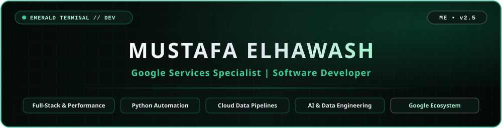

  

  
  
  

  
  
  
  
  

  

---

### ⚡ Executive Overview

I bridge **production software engineering** with **Google's growth and search ecosystem** — building high-performance web systems, Python automation engines, cloud data pipelines, and LLM-powered analytics while scaling businesses across the UAE, Saudi Arabia, Kuwait, Egypt, and global markets.

---

## 💻 Software Developer — Engineering Divisions

My software engineering work is structured into **4 specialized architectural divisions** documented on [mustafaelhawash.com](https://mustafaelhawash.com/):

| Engineering Division | Core Engineered Systems & Capabilities | Architecture & Case Studies |
| :--- | :--- | :--- |
| **1. Full-Stack Web Development & Performance Engineering** | • High-performance **WordPress & WooCommerce** architecture • Core Web Vitals tuning, caching (`WP Rocket` + `Cloudflare`), and server bottleneck resolution • Technical SEO architecture & enterprise store revivals | [Explore Division ↗](https://mustafaelhawash.com/full-stack-performance-engineering/) |
| **2. Python Automation Engineering** | • **Visual Web & Forum Archiving Engine:** High-speed automated capture & archiving • **Interactive Self-Healing Automation Engine:** Resilient execution with auto-recovery scenarios • **Cloud Split-Archive Automation System:** Automated processing & extraction of segmented cloud archives | [Explore Division ↗](https://mustafaelhawash.com/python-automation-engineering/) |
| **3. Cloud Data Pipelines & Integration** | • **Cloud Transfer Bridge & Large File Splitting:** In-memory splitting, `OpenCV` video processing & atomic resume logs • **Concurrent Cloud Backup Engine:** Asyncio parallelism (`Semaphore`, `asyncio.Lock`), local staging & 2FA session handling | [Explore Engine ↗](https://mustafaelhawash.com/concurrent-cloud-backup-engine/) |
| **4. AI & Data Engineering** | • **AI Technical SEO Auditor:** `ThreadPoolExecutor` crawler, `Pandas` health telemetry & `LLM` Structured JSON diagnostics • **AI Data Intelligence Pipeline:** `Pandas` bilingual normalization, batch LLM + `tqdm` checkpointing & `Matplotlib` analytics | [Explore Division ↗](https://mustafaelhawash.com/ai-data-engineering/) |

> 🔒 **Proprietary Code Notice:** Production source repositories for client systems and enterprise automation tools are kept private to protect intellectual property. Full architectural diagrams, isolated engineering modules, and live telemetry dashboards are published on [mustafaelhawash.com](https://mustafaelhawash.com/).

---

## 🎯 Google Services Specialist — Search & Growth Ecosystem

Dedicated technical execution across the Google platform stack to maximize visibility, speed, and measurable ROI:

| Google Service | Technical Scope & Deliverables |
| :--- | :--- |
| **Google Ads** | Full-funnel Search & Display campaign architecture, conversion tracking, and advanced policy/account troubleshooting. |
| **Google Maps** | Google Business Profile optimization, local ranking authority, and geo-targeted map pack dominance. |
| **YouTube Ads** | Precision audience targeting, video ad funnel structuring, and cost-efficient scaling campaigns. |
| **Website Optimization** | Speed engineering, TTFB reduction, Core Web Vitals optimization, `Cloudflare` & `WP Rocket` tuning. |
| **SEO** | Deep technical SEO audits, crawl architecture, semantic hierarchy (`H1–H3`, `Canonical`), and bilingual (AR/EN) ranking strategies. |
| **Competitor Analysis** | Data-driven competitive intelligence, keyword gap extraction, ad benchmarking, and market positioning. |

---

## 🛠️ Tech Stack & Core Competencies

**Software Engineering, Automation & Cloud Pipelines**

  
  
  
  
  
  
  
  
  

**Full-Stack Web & Performance Engineering**

  
  
  
  
  
  

**Google Services Ecosystem**

  
  
  
  
  
  

---

  

